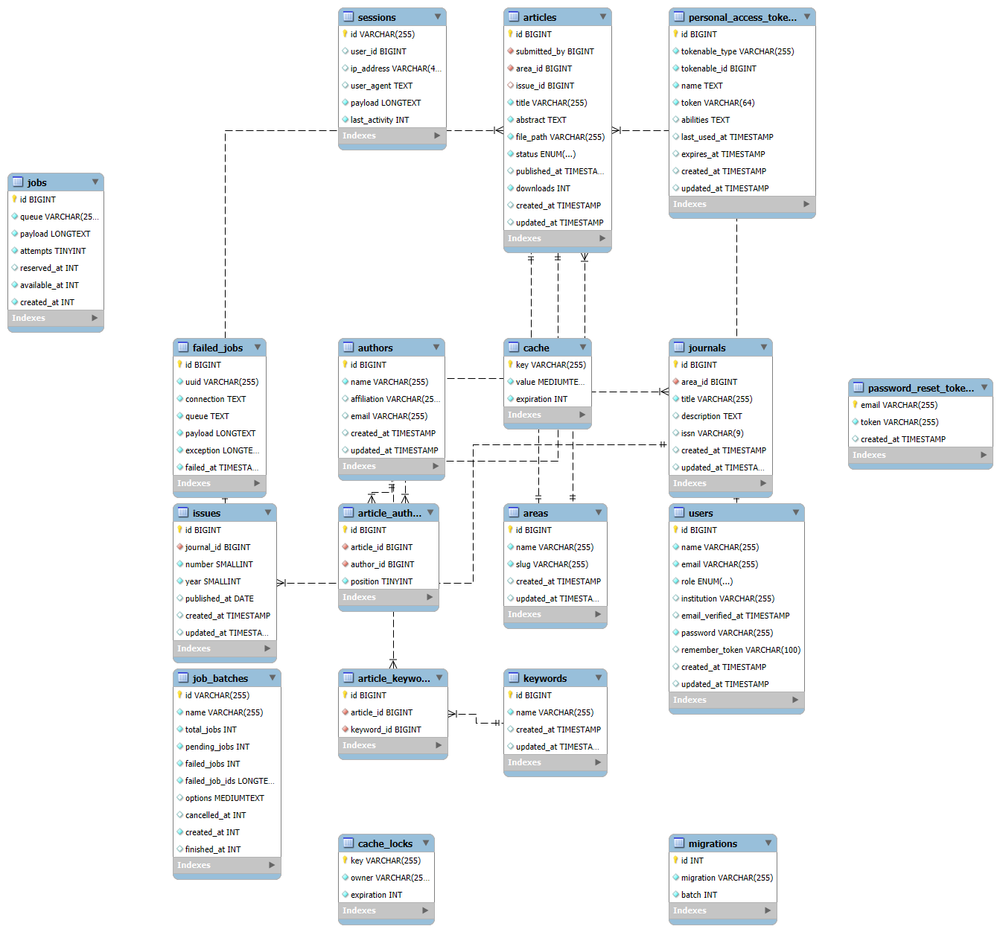

# Pérgamo — Ciência sem Fronteiras

Portal de divulgação científica para publicação e organização de artigos acadêmicos no formato de revistas digitais. A proposta é oferecer uma alternativa simples e de baixo custo às taxas do mercado editorial acadêmico.

Projeto da disciplina **Back-end Frameworks** (Ciência da Computação, 4º período).

**Equipe:** Elano Barros Serrão, Adhan Borges de Souza, Izabel Cristina Martins dos Santos e Luigi Gabriel Lopes dos Santos.

## Tecnologias

| Camada | Tecnologia |
|---|---|
| Back-end | Laravel 12 (API REST) + Laravel Sanctum (autenticação por token) |
| Banco de dados | MySQL 8 (modelagem no MySQL Workbench) |
| Front-end | React 19 com Vite e React Router |
| Testes | PHPUnit (testes automatizados da API) e Postman (testes manuais) |

## Estrutura do repositório

```
pergamo/
├── backend/    API em Laravel
├── frontend/   Aplicação em React (veja frontend/README.md)
├── docs/       Diagrama EER (.png e .mwb) e coleção do Postman
└── README.md
```

## Status do projeto

**Pronto**

- Cadastro, login e logout, com perfis de leitor, pesquisador e administrador
- Catálogo público: áreas, revistas, edições e artigos, com busca, filtros e paginação
- Download do PDF do artigo, com contador de downloads
- Envio de artigos pelo pesquisador, com PDF, edição, troca de arquivo e envio para avaliação
- Publicação de artigos pelo administrador, vinculando a uma edição
- CRUD do administrador para áreas, revistas e edições, e gestão de usuários
- Edição de perfil e troca de senha
- Testes automatizados da API, diagrama EER e coleção do Postman
- Front-end em React completo: páginas públicas, cadastro, login, conta, área do pesquisador e painel do administrador

**Pendente**

- Recuperação de senha e confirmação de e-mail
- Recusar um artigo com um comentário para o autor (hoje o administrador publica ou exclui)
- Testes automatizados do front-end

## Modelo de dados



O banco tem 9 tabelas de domínio: `users`, `areas`, `journals`, `issues`, `articles`, `authors`, `keywords` e as tabelas de ligação `article_author` e `article_keyword`.

## Requisitos

Instale antes de começar:

| Ferramenta | Versão | Observação |
|---|---|---|
| PHP | 8.2 ou superior | Extensões ativas: `pdo_mysql`, `mbstring`, `openssl`, `fileinfo`, `curl`, `zip` |
| Composer | 2.x | getcomposer.org |
| MySQL Server | 8.x | Com o MySQL Workbench |
| Node.js | LTS | Necessário para o front-end |
| Git | qualquer recente | |
| Postman | qualquer recente | Para testar a API |

Se usar o **XAMPP**, o PHP fica em `C:\xampp\php`. As extensões são ativadas no arquivo `php.ini` dessa pasta, removendo o `;` do início da linha (por exemplo, `extension=zip`).

Para conferir:

```powershell
php -v
composer -V
php -m | findstr /i "pdo_mysql mbstring openssl fileinfo curl zip"
```

## Instalação do back-end

**1. Clonar o repositório**

```powershell
git clone https://github.com/SEU-USUARIO/pergamo.git
cd pergamo\backend
```

**2. Instalar as dependências**

```powershell
composer install
```

**3. Criar o arquivo de configuração**

```powershell
Copy-Item .env.example .env
php artisan key:generate
```

O `.env` guarda senhas e **nunca vai para o GitHub**. Cada pessoa tem o seu.

**4. Criar o banco de dados**

Abra o MySQL Workbench, conecte no seu servidor local e rode:

```sql
CREATE DATABASE pergamo CHARACTER SET utf8mb4 COLLATE utf8mb4_unicode_ci;
```

**5. Configurar o `.env`**

Abra `backend/.env` e ajuste o bloco do banco (apague o `#` das linhas que estiverem comentadas):

```
DB_CONNECTION=mysql
DB_HOST=127.0.0.1
DB_PORT=3306
DB_DATABASE=pergamo
DB_USERNAME=root
DB_PASSWORD=SUA_SENHA_DO_MYSQL
```

Atenção à **porta**. Se o MySQL do XAMPP e o MySQL Server estiverem instalados juntos, eles disputam a 3306, e um deles precisa usar outra porta (por exemplo, 3307). Use no `.env` a porta do servidor que você está usando.

**6. Criar as tabelas e os dados de exemplo**

```powershell
php artisan migrate:fresh --seed
```

Esse comando **apaga e recria** todas as tabelas. Use só em desenvolvimento. Ele também cria o PDF de exemplo usado no teste de download.

**7. Subir o servidor**

```powershell
php artisan serve
```

A API fica em `http://127.0.0.1:8000/api`. Mantenha esse terminal aberto. Para testar, abra `http://127.0.0.1:8000/api/areas` no navegador: deve aparecer um JSON com as áreas.

## Instalação do front-end

Com o servidor do Laravel rodando (`php artisan serve`), abra **outro terminal**:

```powershell
cd frontend
npm install
npm run dev
```

Abra `http://localhost:5173`. Em desenvolvimento, o Vite repassa as chamadas `/api` para o Laravel, então não há nada para configurar. Mais detalhes em `frontend/README.md`.

## Usuários de teste

Criados pelo seeder, todos com a senha `senha1234`:

| E-mail | Perfil | O que pode fazer |
|---|---|---|
| `admin@pergamo.test` | admin | Avaliar e publicar artigos, gerenciar áreas, revistas, edições e usuários |
| `pesquisador@pergamo.test` | pesquisador | Enviar e gerenciar os próprios artigos |
| `leitor@pergamo.test` | leitor | Navegar pelo catálogo e baixar artigos |

## Como usar o sistema

Com o back-end e o front-end rodando, abra `http://localhost:5173` e use as contas da tabela acima.

**Leitor (ou visitante)**

1. Em **Artigos**, busque por título, resumo, autor ou palavra-chave e filtre por área.
2. Abra um artigo para ver autores, resumo e palavras-chave, e clique em **Baixar PDF**.
3. Em **Revistas**, navegue pelas edições de cada revista.

**Pesquisador**

1. Entre com `pesquisador@pergamo.test` e abra **Meus artigos**.
2. Clique em **+ Novo artigo**, preencha título, resumo, área, palavras-chave e autores, anexe o PDF e salve. O artigo fica como **Rascunho**.
3. Edite o que precisar ou troque o PDF. Quando estiver pronto, clique em **Enviar para avaliação**.
4. Acompanhe o status na lista: **Rascunho**, **Em avaliação** ou **Publicado**.

**Administrador**

1. Entre com `admin@pergamo.test` e abra **Painel**.
2. Na aba **Avaliação**, veja os artigos em avaliação, leia o PDF e clique em **Publicar…** para escolher a edição.
3. Nas abas **Áreas**, **Revistas** e **Edições**, crie, edite e exclua o conteúdo do catálogo.
4. Na aba **Usuários**, busque pessoas e altere o perfil de acesso delas.

O artigo publicado aparece na hora no catálogo público.

## Testando a API no Postman

1. No Postman, clique em **Import** e selecione os dois arquivos da pasta `docs`:
   - `pergamo.postman_collection.json` (as requisições)
   - `pergamo.postman_environment.json` (as variáveis `base_url` e `token`)
2. Selecione o ambiente `Local` no canto superior direito.
3. Rode uma das requisições de **Login**. O token é guardado na variável `token` e as demais requisições o usam automaticamente.

Se o arquivo do ambiente não estiver na pasta, crie um ambiente `Local` com `base_url` igual a `http://localhost:8000/api` e `token` vazio.

Para trocar de usuário, rode outro login. Como o token é sobrescrito, confira sempre qual foi o último.

Na coleção, a autenticação é do tipo **Bearer Token** com `{{token}}`. Para a API sempre responder em JSON, a aba **Scripts → Pre-request** da coleção tem:

```javascript
if (!pm.request.headers.has("Accept")) {
    pm.request.headers.add({ key: "Accept", value: "application/json" });
}
```

Ao escrever URLs, **não deixe espaço** entre `{{base_url}}` e a barra.

## Rotas da API

Todas começam com `/api`, e são 36 no total. Exemplo: `GET /api/articles`.

**Públicas**

| Método | Rota | Descrição |
|---|---|---|
| POST | `/register` | Cadastro (perfil `leitor` ou `pesquisador`) |
| POST | `/login` | Login, devolve o token |
| GET | `/areas` | Lista as áreas |
| GET | `/journals` | Lista as revistas (`?area=slug`) |
| GET | `/journals/{id}` | Detalhe da revista, com edições |
| GET | `/issues` | Edições recentes (`?per_page=`, `?journal=`, `?area=`) |
| GET | `/issues/{id}` | Detalhe da edição, com artigos publicados |
| GET | `/articles` | Artigos publicados (`?q=`, `?area=`, `?journal=`, `?per_page=`) |
| GET | `/articles/{id}` | Detalhe do artigo |
| GET | `/articles/{id}/download` | Baixa o PDF |

**Usuário logado**

| Método | Rota | Descrição |
|---|---|---|
| POST | `/logout` | Encerra a sessão |
| GET | `/me` | Dados do usuário logado |
| PUT | `/me` | Edita nome, e-mail e instituição |
| PUT | `/me/password` | Troca a senha |
| DELETE | `/articles/{id}` | Exclui artigo (o dono, se não publicado, ou o admin) |

**Pesquisador**

| Método | Rota | Descrição |
|---|---|---|
| GET | `/my/articles` | Lista os próprios artigos, em qualquer status |
| GET | `/my/articles/{id}` | Mostra um dos próprios artigos, inclusive rascunhos |
| POST | `/articles` | Cria artigo (`form-data`, com PDF), como rascunho |
| PUT | `/articles/{id}` | Edita o texto, enquanto não publicado |
| POST | `/articles/{id}/file` | Troca o PDF |
| POST | `/articles/{id}/submit` | Envia o rascunho para avaliação |

**Administrador** (prefixo `/admin`)

| Método | Rota | Descrição |
|---|---|---|
| GET | `/admin/articles` | Fila de avaliação (`?status=`) |
| GET | `/admin/articles/{id}/download` | Lê o PDF de qualquer artigo, publicado ou não |
| PATCH | `/admin/articles/{id}/publish` | Publica numa edição (`issue_id`) |
| POST, PUT, DELETE | `/admin/areas` | CRUD de áreas |
| POST, PUT, DELETE | `/admin/journals` | CRUD de revistas |
| GET, POST, PUT, DELETE | `/admin/issues` | CRUD de edições |
| GET | `/admin/users` | Lista usuários (`?role=`, `?q=`) |
| PATCH | `/admin/users/{id}/role` | Altera o perfil de acesso |

Para ver todas as rotas, rode `php artisan route:list --path=api`.

**Fluxo de um artigo:** `rascunho` → (pesquisador envia) → `submetido` → (admin publica) → `publicado`.

## Testes automatizados

A API tem mais de 80 testes (autenticação, catálogo, envio e publicação de artigos, administração e perfil). Eles usam SQLite em memória e **não alteram o banco MySQL** do projeto.

```powershell
cd backend
php artisan test
```

Requer as extensões `pdo_sqlite` e `sqlite3` do PHP ativas.

## Como trabalhar em equipe (Git)

**Nunca trabalhe direto na `main`.** Cada tarefa tem a sua branch.

```powershell
git checkout main
git pull
git checkout -b feature/nome-da-tarefa
```

Depois de trabalhar:

```powershell
git add .
git commit -m "Descrição curta do que mudou"
git push -u origin feature/nome-da-tarefa
```

No GitHub, aparece o botão **Compare & pull request**. Abra o Pull Request, peça para um colega revisar e faça o merge. Depois, atualize a sua cópia local:

```powershell
git checkout main
git pull
```

**Regras que evitam dor de cabeça:**

- Faça `git pull` na `main` antes de criar uma branch nova, e também antes de começar a editar arquivos que outra pessoa pode ter mexido, como este README.
- Commits pequenos, com mensagem que explique o que mudou (nada de "alterações" ou "teste").
- **Nunca edite uma migration que já foi enviada.** Quem já a executou não vai ver a mudança. Para alterar uma tabela, crie uma migration nova: `php artisan make:migration nome_da_mudanca`.
- Depois de baixar mudanças de outros colegas, rode `composer install` (se o `composer.lock` mudou) e `php artisan migrate` (se há migrations novas).
- O banco de dados **não vai no Git**. Cada um tem o seu, recriado pelas migrations e pelos seeders.
- Nunca envie o `.env`, nem senhas ou tokens.

**Se o `git push` for recusado** ("rejected" ou "non-fast-forward"), alguém enviou mudanças antes de você. Baixe-as primeiro:

```powershell
git pull
```

Se o Git avisar de **conflito**, abra o arquivo indicado, procure as marcas `<<<<<<<`, `=======` e `>>>>>>>`, escolha o texto que deve ficar e apague as marcas. Depois:

```powershell
git add .
git commit -m "Resolve conflito"
git push
```

Para ver o que mudou antes de decidir, use `git diff` (mudanças ainda não salvas) ou `git log -p -3` (últimos commits).

## Problemas comuns

| Sintoma | Causa e solução |
|---|---|
| `npm` bloqueado: "execução de scripts foi desabilitada" | Rode `Set-ExecutionPolicy -Scope CurrentUser -ExecutionPolicy RemoteSigned` no PowerShell |
| `composer install` falha com "zip extension" | Ative `extension=zip` no `php.ini` e reabra o terminal |
| `could not find driver` | Ative `extension=pdo_mysql` no `php.ini` |
| `Access denied for user 'root'` (erro 1045) | A senha do `.env` não bate com a do MySQL |
| `Connection refused` | O MySQL não está rodando, ou a porta do `.env` está errada |
| `Route [login] not defined` | A requisição foi sem token ou sem o cabeçalho `Accept: application/json` |
| 404 com `api%20` na mensagem | Há um espaço na URL da requisição do Postman |
| 403 numa rota que deveria funcionar | O último login foi de outro perfil. Rode o login do usuário certo |
| 401 em tudo | O token expirou ou foi invalidado (por exemplo, após `migrate:fresh`). Faça login de novo |
| Mudou o `.env` e nada mudou | Rode `php artisan config:clear` e reinicie o servidor |
| Erro 500 sem explicação | Veja o final do arquivo `backend/storage/logs/laravel.log` |
| Front-end: "Não foi possível conectar à API" | O servidor do Laravel não está rodando. Rode `php artisan serve` na pasta `backend` |
| `npm run dev` falha ou a tela fica em branco | Rode `npm install` na pasta `frontend` e confira se o Node.js está instalado (`node -v`) |
| Upload de PDF falha | O PHP limita uploads a 2 MB por padrão. Aumente `upload_max_filesize` e `post_max_size` no `php.ini` |

## Referências

- Laravel: https://laravel.com/docs
- React: https://react.dev/
- Vite: https://vite.dev/
- MySQL 8.4: https://dev.mysql.com/doc/refman/8.4/en/
- MySQL Workbench: https://dev.mysql.com/doc/workbench/en/
